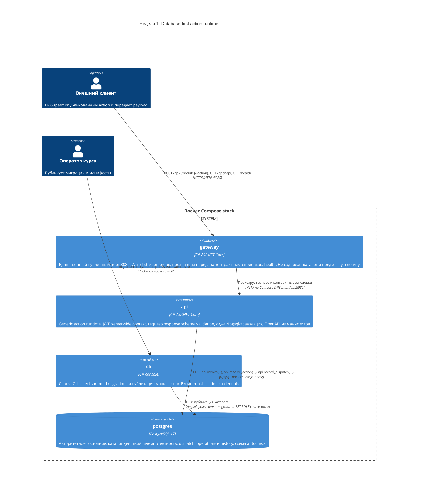

# C4, уровень 2: Container diagram

Диаграмма фиксирует ответственность контейнеров и направление вызовов. Единственная публичная
точка входа — `gateway` на порту `8080`. Предметное выполнение существует только внутри
PostgreSQL, за функцией `api.invoke`.



## Границы доверия

| Граница | Что проверяется | Где |
|---|---|---|
| Edge | Whitelist маршрутов, отсутствие предметной логики и БД | `gateway` |
| Runtime | Подпись и форма claims JWT, policy, request schema, outcome и response schema | `api` |
| Database | Разрешение target только из каталога, повторная проверка policy, точная сигнатура функции, идемпотентность | `api.invoke` |
| Roles | `course_runtime` не имеет DML к предметным таблицам, owner `SECURITY DEFINER` имеет `NOLOGIN` | PostgreSQL |

## Поток одного вызова

```mermaid
sequenceDiagram
    autonumber
    participant C as Клиент
    participant G as gateway
    participant A as api
    participant P as PostgreSQL

    C->>G: POST /api/{module}/{action} + Authorization + Idempotency-Key
    G->>A: тот же запрос по Compose DNS
    A->>A: проверка JWT, формирование context (correlationId, deadline)
    A->>P: api.resolve_action(module, action, version)
    A->>A: policy и request schema
    A->>P: BEGIN; SET LOCAL statement_timeout; SELECT api.invoke(...)
    P->>P: каталог → policy → idempotency → зарегистрированная функция
    P-->>A: единый envelope
    A->>A: outcome ∈ outcomes, result по response schema
    alt контракт соблюдён
        A->>P: COMMIT
    else нарушение контракта или ошибка target
        A->>P: ROLLBACK
    end
    A->>P: api.record_dispatch(...) на отдельном соединении
    A-->>G: envelope
    G-->>C: envelope
```
