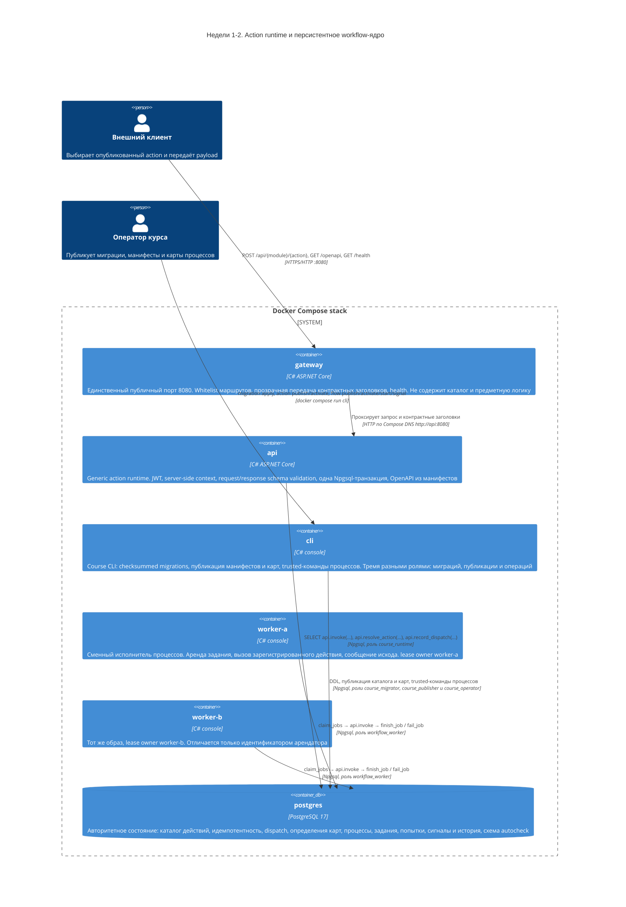
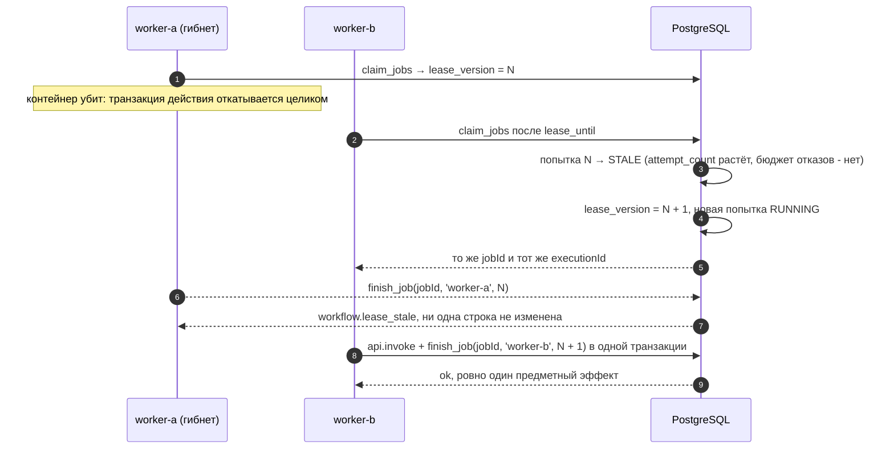

# C4, уровень 2: Container diagram

Диаграмма фиксирует ответственность контейнеров и направление вызовов. Единственная публичная
точка входа — `gateway` на порту `8080`. Предметное выполнение существует только внутри
PostgreSQL, за функцией `api.invoke`, — и для HTTP-клиента, и для исполнителя процессов.



## Границы доверия

| Граница | Что проверяется | Где |
|---|---|---|
| Edge | Whitelist маршрутов, отсутствие предметной логики и БД | `gateway` |
| Runtime | Подпись и форма claims JWT, policy, request schema, outcome и response schema | `api` |
| Worker | Mapping по указателям RFC 6901, request schema, объявленность исхода, response schema | `worker-*` |
| Database | Разрешение target только из каталога, повторная проверка policy, точная сигнатура функции, идемпотентность | `api.invoke` |
| Lease | Совпадение задания, владельца, версии аренды и состояния до единой записи | `workflow.finish_job` |
| Roles | `course_runtime` без DML и без доступа к схеме `workflow`; `workflow_worker` — четыре функции и ноль DML; `course_publisher` меняет только определения, `course_operator` — только исполнение; owner `SECURITY DEFINER` имеет `NOLOGIN` | PostgreSQL |

## Поток одного HTTP-вызова

```mermaid
sequenceDiagram
    autonumber
    participant C as Клиент
    participant G as gateway
    participant A as api
    participant P as PostgreSQL

    C->>G: POST /api/{module}/{action} + Authorization + Idempotency-Key
    G->>A: тот же запрос по Compose DNS
    A->>A: проверка JWT, формирование context (correlationId, deadline)
    A->>P: api.resolve_action(module, action, version)
    A->>A: policy и request schema
    A->>P: BEGIN; SET LOCAL statement_timeout; SELECT api.invoke(...)
    P->>P: каталог → policy → idempotency → зарегистрированная функция
    P-->>A: единый envelope
    A->>A: outcome ∈ outcomes, result по response schema
    alt контракт соблюдён
        A->>P: COMMIT
    else нарушение контракта или ошибка target
        A->>P: ROLLBACK
    end
    A->>P: api.record_dispatch(...) на отдельном соединении
    A-->>G: envelope
    G-->>C: envelope
```

## Поток одной попытки задания

Аренда берётся короткой транзакцией и сразу фиксируется; действие выполняется вне неё. Право на
завершение предъявляется парой «владелец + версия аренды» и проверяется заново — до единой записи.

```mermaid
sequenceDiagram
    autonumber
    participant WA as worker-a
    participant WB as worker-b
    participant P as PostgreSQL

    WA->>P: SELECT workflow.claim_jobs('worker-a', 1, lease)
    P->>P: FOR UPDATE SKIP LOCKED; срок = max(lease, timeout_ms + запас); lease_version++; attempt_count++
    P-->>WA: закреплённый контракт: версия действия, схемы, outcomes, policy, mapping, данные процесса
    WB->>P: SELECT workflow.claim_jobs('worker-b', 1, lease)
    P-->>WB: пусто, задание арендовано
    WA->>WA: payload из констант и mapping; проверка по request schema

    WA->>P: BEGIN; SET LOCAL statement_timeout
    WA->>P: SELECT api.invoke(..., context с executionId, payload)
    P->>P: каталог → policy → idempotency по executionId → зарегистрированная функция
    P-->>WA: единый envelope
    WA->>WA: outcome ∈ outcomes, result по response schema

    alt контракт соблюдён
        WA->>P: SELECT workflow.finish_job(jobId, owner, leaseVersion, outcome, result, dispatch)
        P->>P: fencing → попытка SUCCEEDED → шаг COMPLETED → dispatch → переход и вход в следующий шаг
        WA->>P: COMMIT
    else ошибка действия, нарушение контракта или таймаут
        WA->>P: ROLLBACK
        WA->>P: SELECT workflow.fail_job(jobId, owner, leaseVersion, code, retryable, dispatch)
        P->>P: попытка FAILED → след ERROR → RETRY_WAIT с задержкой или DEAD, событие TaskFailed
    end
```

## Что происходит при гибели арендатора


