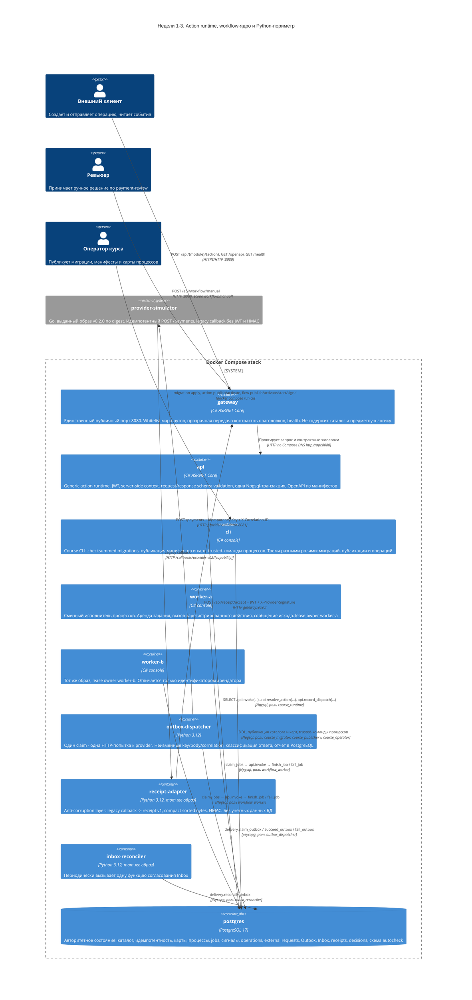
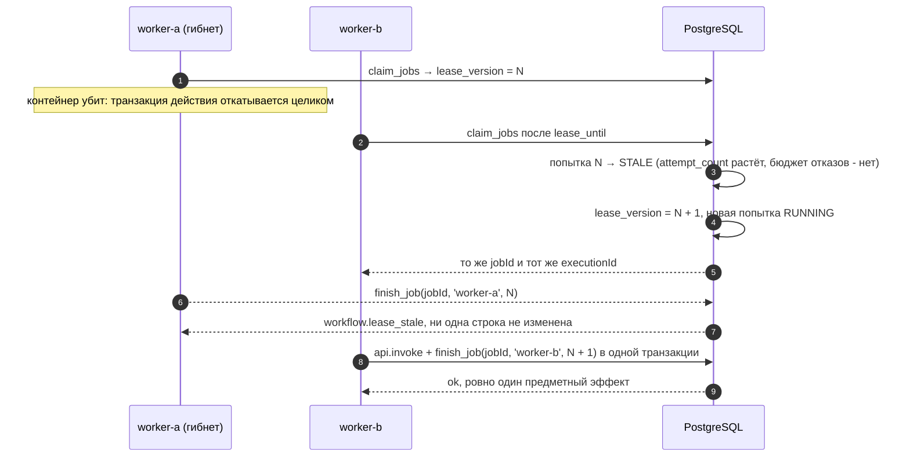
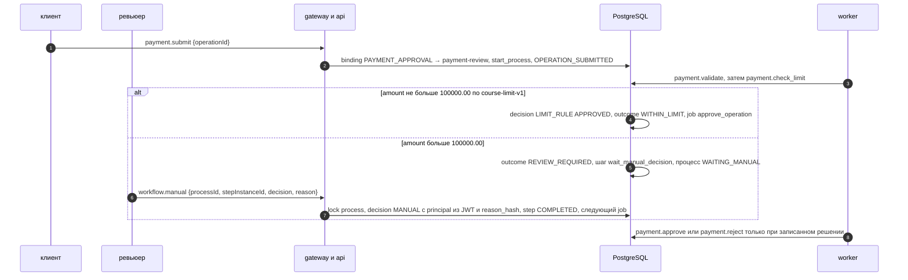

# C4, уровень 2: Container diagram

Диаграмма фиксирует ответственность контейнеров и направление вызовов. Единственная публичная
точка входа — `gateway` на порту `8080`. Предметное выполнение существует только внутри
PostgreSQL, за функцией `api.invoke`, — и для HTTP-клиента, и для исполнителя процессов.

Неделя 3 добавляет интеграционный периметр: три Python-процесса из одного образа и выданный
provider v0.2.0. Python переводит форматы и носит байты через фиксированные границы, но не
выбирает карту, лимит, переход или финальный статус. См.
[ADR 0005](adr/0005-provider-trust-boundary-and-anti-corruption-layer.md) и
[ADR 0006](adr/0006-durable-outbox-and-inbox.md).



## Границы доверия

| Граница | Что проверяется | Где |
|---|---|---|
| Edge | Whitelist маршрутов, отсутствие предметной логики и БД | `gateway` |
| Runtime | Подпись и форма claims JWT, policy, request schema, outcome и response schema | `api` |
| Worker | Mapping по указателям RFC 6901, request schema, объявленность исхода, response schema | `worker-*` |
| Database | Разрешение target только из каталога, повторная проверка policy, точная сигнатура функции, идемпотентность | `api.invoke` |
| Publication | Форма шага (`automatic` → `task`, `wait_signal` → `signal_type` и `outcome`, `end` → `outcome`), объявленность `start_step` и обоих концов каждого перехода | `workflow.publish_flow`, CHECK `workflow.step_definition` |
| Lease | Совпадение задания, владельца, версии аренды и состояния до единой записи | `workflow.finish_job` |
| Identity | Неизменяемость `execution_id`, закрепления процесса за версией, тела принятого сигнала и невозможность отмотать `lease_version` назад | триггеры `workflow.*_identity` |
| Roles | `course_runtime` без DML и без доступа к схеме `workflow`; `workflow_worker` — четыре функции и ноль DML; `course_publisher` меняет только определения, `course_operator` — только исполнение; owner `SECURITY DEFINER` имеет `NOLOGIN` | PostgreSQL |
| Provider edge | Capability-сегмент пути (constant-time), строгая схема legacy callback, запрет CR/LF и unknown fields, лимит 64 KiB | `receipt-adapter` |
| Signature | HMAC-SHA256 над точными байтами тела до разбора JSON; в context только `transport.signatureVerified` и `signatureVersion` | `api`, `SignatureBoundary` |
| Receipt | Маркер подписи, версия, известный `externalRequestId`, глобальный `messageId` и SHA-256 тела | `payment.receipt_accept_v1` |
| Delivery | Owner и `lease_version` до записи; `CONFIRMED` не регрессирует; ключ и тело Outbox неизменяемы | `delivery.*`, триггеры `outbox_guard`, `inbox_guard` |
| Evidence | Финальный статус только по применённой квитанции или записанному решению | `payment.complete_v1`, `reject_v1`, `approve_v1` |
| Integration roles | `outbox_dispatcher` — три функции, `inbox_reconciler` — одна; ноль прав на таблицы, `CREATE` и членств; у adapter нет учётных данных БД | PostgreSQL, Compose |

## Поток одного HTTP-вызова

```mermaid
sequenceDiagram
    autonumber
    participant C as Клиент
    participant G as gateway
    participant A as api
    participant P as PostgreSQL

    C->>G: POST /api/{module}/{action} + Authorization + Idempotency-Key
    G->>A: тот же запрос по Compose DNS
    A->>A: проверка JWT, формирование context (correlationId, deadline)
    A->>P: api.resolve_action(module, action, version)
    A->>A: policy и request schema
    A->>P: BEGIN; SET LOCAL statement_timeout; SELECT api.invoke(...)
    P->>P: каталог → policy → idempotency → зарегистрированная функция
    P-->>A: единый envelope
    A->>A: outcome ∈ outcomes, result по response schema
    alt контракт соблюдён
        A->>P: COMMIT
    else нарушение контракта или ошибка target
        A->>P: ROLLBACK
    end
    A->>P: api.record_dispatch(...) на отдельном соединении
    A-->>G: envelope
    G-->>C: envelope
```

## Поток одной попытки задания

Аренда берётся короткой транзакцией и сразу фиксируется; действие выполняется вне неё. Право на
завершение предъявляется парой «владелец + версия аренды» и проверяется заново — до единой записи.

```mermaid
sequenceDiagram
    autonumber
    participant WA as worker-a
    participant WB as worker-b
    participant P as PostgreSQL

    WA->>P: SELECT workflow.claim_jobs('worker-a', 1, lease)
    P->>P: SKIP LOCKED; срок = min(max(lease, timeout_ms+запас), lease*3); lease_version++; attempt_count++
    P-->>WA: закреплённый контракт: версия действия, схемы, outcomes, policy, mapping, данные процесса
    WB->>P: SELECT workflow.claim_jobs('worker-b', 1, lease)
    P-->>WB: пусто, задание арендовано
    WA->>WA: payload из констант и mapping; проверка по request schema

    WA->>P: BEGIN; SET LOCAL statement_timeout
    WA->>P: SELECT api.invoke(..., context с executionId, payload)
    P->>P: каталог → policy → idempotency по executionId → зарегистрированная функция
    P-->>WA: единый envelope
    WA->>WA: outcome ∈ outcomes, result по response schema

    alt контракт соблюдён
        WA->>P: SELECT workflow.finish_job(jobId, owner, leaseVersion, outcome, result, dispatch)
        P->>P: fencing → попытка SUCCEEDED → шаг COMPLETED → dispatch → переход и вход в следующий шаг
        WA->>P: COMMIT
    else ошибка действия, нарушение контракта или таймаут
        WA->>P: ROLLBACK
        WA->>P: SELECT workflow.fail_job(jobId, owner, leaseVersion, code, retryable, dispatch)
        P->>P: попытка FAILED → след ERROR → RETRY_WAIT с задержкой или DEAD, событие TaskFailed
    end
```

## Что происходит при гибели арендатора



## Периметр: provider path

`payment.prepare_external` фиксирует external request и Outbox одной транзакцией с завершением
задания, поэтому к моменту HTTP запрос уже durable. Ответ provider и callback — независимые
события: callback может подтвердить доставку раньше, чем dispatcher отчитается.

```mermaid
sequenceDiagram
    autonumber
    participant W as worker
    participant P as PostgreSQL
    participant D as outbox-dispatcher
    participant S as provider v0.2.0
    participant A as receipt-adapter
    participant G as gateway и api
    participant R as inbox-reconciler

    W->>P: api.invoke(payment.prepare_external) + finish_job
    P->>P: external_request CREATED + outbox PENDING + wait_receipt WAITING_SIGNAL в одной транзакции
    D->>P: delivery.claim_outbox(owner, 1)
    P-->>D: outbox_id, lease_version, externalRequestId, correlationId, amount, currency
    D->>S: POST /payments, Idempotency-Key = externalRequestId
    alt 202 и строгое тело ACCEPTED
        D->>P: delivery.succeed_outbox(id, owner, lease_version, providerPaymentId)
    else timeout, 408, 429, 5xx
        D->>P: delivery.fail_outbox(id, owner, lease_version, code)
        P->>P: RETRY_WAIT и next_attempt_at из политики; повтор с теми же байтами и ключом
    end
    S->>A: legacy callback
    A->>A: строгая валидация, receipt v1, compact sorted bytes, HMAC
    A->>G: POST /api/receipt/accept, JWT receipt-provider, Idempotency-Key = messageId, подпись
    G->>P: подпись верна, api.invoke(receipt.accept) с transport marker
    P->>P: inbox RECEIVED + receipt + outbox и external_request CONFIRMED, commit
    G-->>A: 200 RECEIVED
    A-->>S: тот же статус и тело
    R->>P: delivery.reconcile_inbox(50)
    P->>P: процесс ждёт payment.receipt: signal APPLIED, inbox APPLIED, job apply_receipt
    W->>P: payment.apply_receipt берёт outcome из сохранённой квитанции, затем complete или reject
```

## Периметр: payment-review


